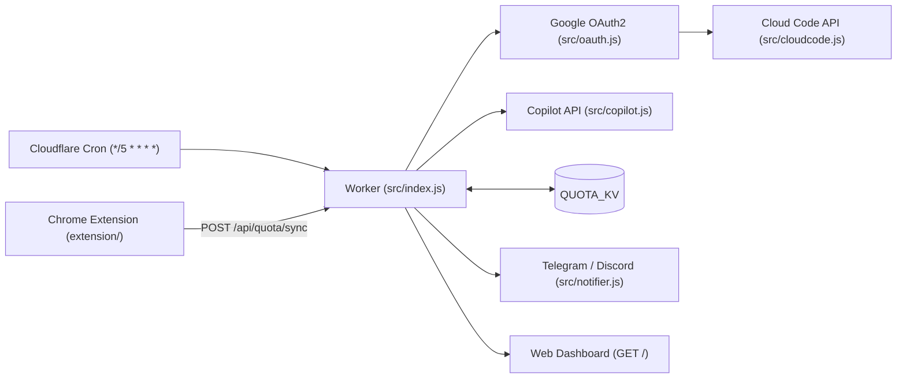

# Quota Reset Automation Notifier

[](https://github.com/gintingism/quota-reset-automation-notifier/actions/workflows/ci.yml)
[](https://github.com/gintingism/quota-reset-automation-notifier/blob/main/LICENSE)

Cloudflare Worker that checks Antigravity and GitHub Copilot quotas every 5 minutes, sends alerts to Telegram or Discord, and sends a `"1+1"` wake request whenever a 5-hour Antigravity pool resets to 100% so the next 5-hour timer starts immediately.

An optional Chrome extension in `extension/` reads `gemini.google.com/usage` in the browser and pushes Gemini Web limits to the same Worker dashboard.

## Architecture



## What each provider tracks

| Provider | Source | Tracked Windows | Auto-Wake | Alerts |
| :--- | :--- | :--- | :--- | :--- |
| **Antigravity** (`src/cloudcode.js`) | `daily-cloudcode-pa.googleapis.com` | Gemini (5h + Weekly), Claude & GPT (5h + Weekly), Gemini 4 Argon (Weekly) | Yes, per 5h pool (`"1+1"`, max 16 tokens) | Wake, Reset, Low Quota, Auth Expired |
| **GitHub Copilot** (`src/copilot.js`) | `api.github.com/copilot_internal/user` | Monthly AI credits (`credits_used`, `credits_remaining`, `entitlement`) | No (monthly cycle only) | Low Quota, Monthly Reset |
| **Gemini Web** (`extension/`) | `gemini.google.com/usage` DOM (EN & ID) | 5h/session (`dailyUsed`), Weekly (`weeklyUsed`) | No (browser session only) | Low Quota |

## Auto-Wake guards (`src/wake_engine.js`)

Each pool with a `5H` window (`Gemini Models` and `Claude and GPT models`) is evaluated independently. A wake request runs only when all checks pass:

1. `remaining_fraction >= 1.0` (100% full).
2. `now >= lastTriggeredResetAt + 2 min` (prevents re-triggering while a 5-hour window is already active).
3. `now - lastTriggerAt >= 10 min` (cooldown).
4. `reset_time_iso !== lastTriggeredResetAt` (new reset cycle).
5. Current local time is inside `WAKE_TIME_WINDOW` (if set) and the pool's weekly limit is above `0%`.

## Setup

### 1. Install dependencies and log in to Cloudflare

```powershell
npm install
npx wrangler login
```

### 2. Get your Antigravity refresh token (one-time)

Set `ANTIGRAVITY_CLIENT_ID` and `ANTIGRAVITY_CLIENT_SECRET` in your shell, then run the OAuth helper:

```powershell
$env:ANTIGRAVITY_CLIENT_ID = "<client-id>"
$env:ANTIGRAVITY_CLIENT_SECRET = "<client-secret>"
npm run auth
```

Open the printed URL, sign in with your Google account, and copy the `ANTIGRAVITY_REFRESH_TOKEN`.

### 3. Create KV namespace and configure `wrangler.toml`

```powershell
npx wrangler kv namespace create QUOTA_KV
```

Copy the generated namespace `id` into `wrangler.toml` under `[[kv_namespaces]]`.

### 4. Set Cloudflare secrets and deploy

```powershell
npx wrangler secret put AUTH_TOKEN
npx wrangler secret put ANTIGRAVITY_CLIENT_ID
npx wrangler secret put ANTIGRAVITY_CLIENT_SECRET
npx wrangler secret put ANTIGRAVITY_REFRESH_TOKEN
npx wrangler secret put TELEGRAM_BOT_TOKEN
npx wrangler secret put TELEGRAM_CHAT_ID
# Optional:
npx wrangler secret put DISCORD_WEBHOOK_URL
npx wrangler secret put GITHUB_TOKEN

npm run deploy
```

## Configuration (`wrangler.toml`)

| Variable | Default | Description |
| :--- | :--- | :--- |
| `AUTO_WAKE_ENABLED` | `"true"` | Enable or disable automatic wake pings |
| `WAKE_GEMINI_MODEL` | `"gemini-3-flash"` | Model used to wake the Gemini 5h pool |
| `WAKE_CLAUDE_MODEL` | `"claude-sonnet-5-5-medium"` | Model used to wake the Claude & GPT 5h pool |
| `WAKE_PROMPT` | `"1+1"` | Prompt text sent on wake |
| `WAKE_MAX_OUTPUT_TOKENS` | `"16"` | Output token cap for wake requests |
| `WAKE_TIME_WINDOW` | `""` | Optional local window like `"07:00-23:00"`, empty for 24/7 |
| `TIMEZONE_OFFSET_HOURS` | `"7"` | UTC offset in hours (`7` for WIB) |
| `LOW_QUOTA_THRESHOLD` | `"20"` | Percentage threshold for low-quota alerts |
| `NOTIFY_ON_WAKE` | `"true"` | Send alert when Auto-Wake executes |
| `NOTIFY_ON_RESET` | `"true"` | Send alert when a window resets to 100% |

## Endpoints

| Method & Path | Auth | Purpose |
| :--- | :--- | :--- |
| `GET /` | Public (read-only) | HTML dashboard with quota pools, timers, and manual controls |
| `GET /health` | Public | Health check (`{"ok":true,"service":"quota-reset-automation"}`) |
| `GET /api/quota/latest` | `X-Auth-Token` | Latest normalized JSON snapshot from `QUOTA_KV` |
| `POST /api/quota/sync` | `X-Auth-Token` | Merge external v1 provider snapshots (used by `extension/`) |
| `POST /api/automation/tick` | `X-Auth-Token` | Run one sync and Auto-Wake check immediately |
| `POST /api/automation/wake` | `X-Auth-Token` | Force an immediate wake ping |

## Chrome extension (`extension/`)

1. Open `chrome://extensions`, enable **Developer mode**, click **Load unpacked**, and select `extension/`.
2. Open the extension popup, enter your Worker URL and `X-Auth-Token`, click **Simpan Pengaturan**, then **Sync Sekarang**.
3. While Chrome is open, it reads `gemini.google.com/usage` (English and Indonesian UI) every 15 minutes and posts the result to `/api/quota/sync`.

## Documentation & Tests

- [Architecture](docs/Architecture.md)
- [Setup and Secrets](docs/Setup-and-Secrets.md)
- Run unit tests locally:

```powershell
npm test
```
